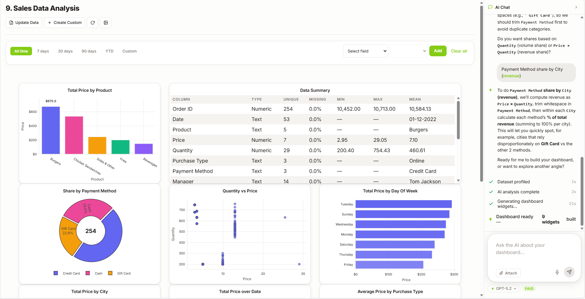
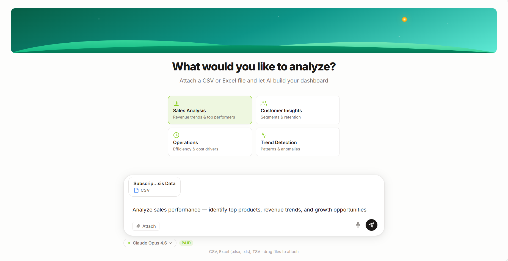
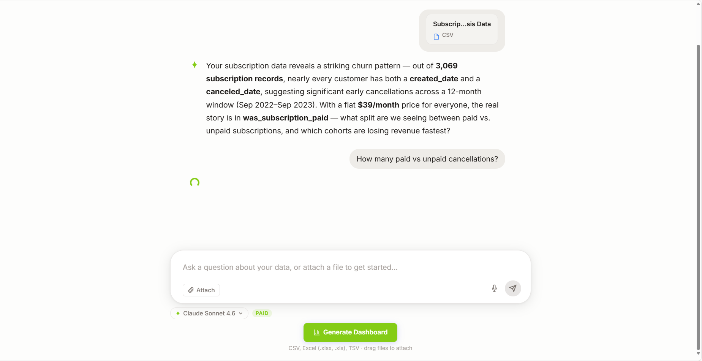
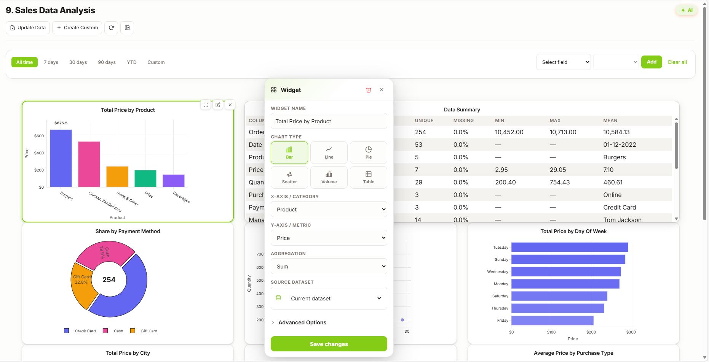
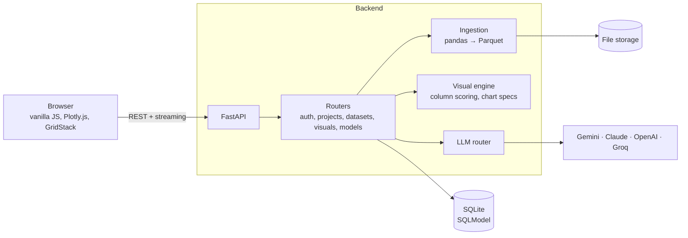

<p align="center">
  <picture>
    <source media="(prefers-color-scheme: dark)" srcset="frontend/logo-dark.png">
    
  </picture>
</p>

<p align="center">
  <b>Drop in a spreadsheet, say what you want to know, and get an interactive dashboard.</b>
</p>

<p align="center">
  
  
  
  
  
  
  
</p>



Hillside AI is a web app I built that turns a CSV or Excel file into a dashboard. It profiles the data,
talks through what you want to learn, then builds a page of charts, KPI cards and tables that you can filter,
rearrange and edit, by hand or by asking the AI. *(The project started under the name ONYX, hence the
repository name.)*

## How it works

| 1. Pick a goal and attach a file | 2. Talk it through | 3. Edit any chart |
|---|---|---|
|  |  |  |
| Choose sales, customers, operations or trends, or type your own question. | The AI reads the data's profile, points out what stands out, and asks what matters before it builds anything. | Change the chart type, axes and aggregation, drag and resize widgets, or ask the AI to refine the dashboard. |

## Features

- **Upload** CSV, TSV and Excel (`.xlsx`, `.xls`, `.xlsb`) files. Uploads are converted to Parquet for fast reloads.
- **Profiling:** column types, unique values, missing values, min, max and mean, shown as a summary table.
- **Automatic dashboards:** a rules engine scores every column and picks KPI cards, bar, line, pie, scatter and
  histogram charts, tables, and maps when it finds latitude and longitude. It also adds views such as
  totals by day of week or hour of day, and conversion rates for yes/no columns.
- **AI chat** that builds and refines dashboards, with streamed responses.
- **Choose your model:** 13 models from Google Gemini, Anthropic Claude, OpenAI and Groq, 7 of them free tier.
- **Filters:** date ranges (7, 30 or 90 days, year to date, custom) and field filters, applied to every chart.
- **Combine data:** join two datasets on matching key columns, or stack files with the same layout.
- **Projects and accounts:** email and password (JWT) or Google sign-in. Work done as a guest moves to your
  account when you sign up.
- **Export** the data to CSV, and save the key insights as a PNG.

## Architecture



The backend does the analysis and sends chart specifications; the frontend draws them with Plotly.js and
lays them out on a GridStack grid.

## Run it locally

```bash
git clone https://github.com/vikwillberg/Onyx-AI.git
```

```bash
cd Onyx-AI && python -m venv .venv
```

```bash
source .venv/bin/activate      # Windows: .venv\Scripts\Activate.ps1
```

```bash
pip install -r backend/requirements.txt
```

```bash
uvicorn app.main:app --app-dir backend --port 8002
```

Then open <http://127.0.0.1:8002>. The `Datasets/` folder has about 30 public sample datasets to try
(sales, pizza orders, subscriptions, web sessions and more).

### AI providers (optional)

Create `backend/.env` with a key for any provider you want to use. Groq and Gemini both have free tiers.

```bash
GROQ_API_KEY=your-key        # https://console.groq.com
GEMINI_API_KEY=your-key      # https://aistudio.google.com
CLAUDE_API_KEY=your-key      # https://console.anthropic.com
OPENAI_API_KEY=your-key      # https://platform.openai.com
```

| Variable | Default | Purpose |
|---|---|---|
| `JWT_SECRET_KEY` | `change-me` | Signs login tokens. Set your own in production. |
| `DATABASE_URL` | `sqlite:///./app.db` | Database connection |
| `STORAGE_DIR` | `./storage` | Where uploaded files are kept |
| `CORS_ORIGINS` | `["http://localhost:3000"]` | Allowed browser origins |
| `GOOGLE_CLIENT_ID`, `GOOGLE_CLIENT_SECRET` | *(empty)* | Turns on "Sign in with Google" |

### Deploy

`render.yaml` describes the service for [Render](https://render.com): connect the repository as a Blueprint
and it installs the backend, generates a JWT secret and starts the server.

## Project layout

```text
backend/app/
├── main.py              # FastAPI app; also serves the frontend
├── routers/             # auth, Google sign-in, projects, datasets, visuals, models
├── services/
│   ├── ingestion.py     # file reading, profiling, merge and stack
│   ├── visuals.py       # column scoring and chart selection
│   ├── llm.py           # model registry and provider calls
│   └── storage.py
├── models.py, schemas.py, db.py
└── core/                # settings, auth helpers
frontend/                # index.html, app.js, styles.css
Datasets/                # sample data
render.yaml              # Render deployment
```

---

Built by **Viktor Berg** · [LinkedIn](https://www.linkedin.com/in/viktor-berg-915616205) · Released under the [MIT License](Onyx-AI/LICENSE)
